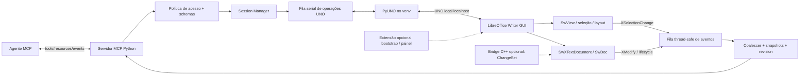

# Arquitetura recomendada do Yberu Writer MCP

## Decisão

Começar por MCP Python e PyUNO no mesmo processo do venv, mais uma sessão LibreOffice explicitamente habilitada. Serializar chamadas UNO numa fila de worker; listeners só publicam invalidações para uma fila de eventos. Não implementar chamadas UNO arbitrárias nem um “shell C++ remoto”. Extensão opcional trata bootstrap/UI; patch core só para delta semântico ou IDs persistentes comprovadamente necessários.

## Componentes



### Responsabilidade

1. **MCP server:** valida JSON Schema, permission scope, limites de tamanho, timeout e retorno consistente. Tool handlers não guardam proxies UNO de forma persistente entre reconexões.
2. **Session manager:** conecta por host/port permitido, lista componentes, identifica Writer por service/types, administra estados `disconnected/connecting/ready/degraded/reconnecting` e profile/process ownership.
3. **UNO worker:** único ponto para chamadas síncronas; fila serial e timeout. Ao detectar `DisposedException`/bridge perdida, invalida proxies e chama reconnect com backoff limitado.
4. **Document registry:** `document_id` opaco gerado pelo MCP (não URL fornecido pelo cliente), mapping a proxy atual, título, URL sanitizada, tipo, dirty/read-only e `revision` local.
5. **Text engine:** conversão de cursores/ranges, parágrafos e outline; suporta paging, chunks e hash. Sempre distingue corpo, célula, frame, header/footer e seleção.
6. **Formatting/table/object adapters:** allowlists específicas de propriedades, unidades e tipos. Evitar aceitar mapa arbitrário de propriedades UNO.
7. **Dispatch adapter:** mapa de ações permitidas para `.uno:` com schemas explícitos e verificação pós-execução.
8. **Event subsystem:** callback leve -> fila -> debounce -> leitura de estado; publicar eventos MCP resumidos. XModify não é delta exato.
9. **Audit log/revision service:** tool, documento, ator `mcp`, precondição, operação e resultado; omitir conteúdo pessoal por defeito ou aplicar política de redaction.
10. **Extensão (opcional):** iniciar sessão/listener por escolha do utilizador, painel e comandos Yberu. Não deve conter servidor externo de privilégios arbitrários.
11. **Bridge C++ (opcional):** API de ChangeSet só depois de avaliar extensão/snapshots; baixo escopo, versionada e acompanhada por testes.

## Sessões e conexões

- Listener local `socket,host=127.0.0.1,port=...`; nunca `0.0.0.0` por padrão. Porta escolhida por launcher e coordenada com processo, sem corrida de bind.
- Perfis `UserInstallation` independentes para instâncias que o MCP inicia; não abrir o mesmo profile concorrente em dois processos.
- Na sessão de trabalho GUI, o utilizador deve iniciar pelo launcher/integração configurada ou instalar extensão. Não presumir que sessão existente aceita socket UNO.
- Auto-start/reconnect é tentativa com limite e visibilidade; não relançar silenciosamente um documento com alterações não guardadas.
- Sessão aberta pelo utilizador permanece sob propriedade do utilizador: MCP não chama `desktop.terminate()` nem fecha documentos fora do seu escopo.

## Revisões e alvos

`document_id` é handle do MCP e é válido enquanto o proxy/session mapping existir. Cada resposta de leitura inclui:

```json
{
  "document_id": "doc_opaque_7f…",
  "revision": 42,
  "read_only": false,
  "dirty": true,
  "selection_kind": "text",
  "content": {"text": "…", "start": 120, "end": 138},
  "snapshot_hash": "sha256:…"
}
```

Âncora `paragraph_ref` combina, quando houver: bookmark nomeado gerido pelo MCP, caminho estrutural (heading/índice), texto de contexto anterior/posterior, range, hash e revisão de origem. Offset absoluto sozinho não é identidade estável. Para escrever, re-resolver e conferir `expected_text`/hash; conflito retorna `CONFLICT` e conteúdo atual. Nunca retarget silenciosamente a uma frase parecida.

## Lote, atomicidade e idempotência

- `batch_id` opcional para auditar e suprimir repetição de pedido. Idempotency key guarda resultado curto e expirável, não object proxy.
- `XUndoManager.enterUndoContext/leaveUndoContext` agrupa ações no histórico, mas não promete transação ACID. Antes do lote validar todas as preconditions; depois reler e confirmar. Se falhar no meio, tentar rollback apenas no undo context pertencente ao MCP e reler; caso incerto, retornar `PARTIAL_FAILURE`.
- Destrutivas: delete/replace amplo, aceitar/rejeitar revisão, fechar/guardar sobre caminho, export com overwrite, reformat all. Pedir confirmação configurável no host MCP.
- Writes devem ter escopo de menor privilégio; leitura não chama dispatch e não altera seleção por padrão. Ferramenta de “focus/select” é operação visual separada.

## Erros e timeouts

Envelope uniforme: `{code, message, retryable, document_id?, current_revision?, details?}`.

- `NO_SESSION`, `NOT_WRITER_DOCUMENT`, `DOCUMENT_DISPOSED`, `UNO_TIMEOUT`, `PERMISSION_DENIED`, `CONFLICT`, `ANCHOR_NOT_FOUND`, `AMBIGUOUS_ANCHOR`, `UNSUPPORTED_PROPERTY`, `UNSUPPORTED_COMMAND`, `READ_ONLY`, `PARTIAL_FAILURE`, `TOO_LARGE`.
- Respostas longas têm cursor de paginação opaque e `revision` fixa; rejeitar paginação se revision mudou ou oferecer restart.
- Timeout MCP não interrompe necessariamente uma chamada UNO já em andamento. Tool informa resultado `UNKNOWN_OUTCOME` se a conexão caiu durante mutação; o cliente primeiro relê estado.
- Cancelamento pode remover operação que ainda não começou; chamadas em execução devem ser reconciliadas, não fingir que foram revertidas.

## Arquitetura de eventos

Event stream MCP de alto nível: `session_state`, `document_dirty`, `selection_changed`, `document_closed`, `document_opened`, `reconnected`, `mcp_operation_completed`. Não enviar cada XModify como operação. Coalesce por documento, garantir limite/backpressure, inclui monotonic sequence do MCP e revision do snapshot. `selection_changed` relê selection no worker antes de publicar dados; proteção de privacidade permite publicar apenas tipo/length até o agente pedir conteúdo.

## Compatibilidade

Fixar versão suportada LibreOffice/PyUNO. Integração de build atual mistura sistema 24.2, wrapper Codex 26.8 alpha e fonte master 2026.10. Não anunciar apoio a 26.8 até executar todos os PoCs e testes de API com os módulos PyUNO e bibliotecas do mesmo runtime. Manter adaptação por `getTypes()`/`queryInterface` e capability flags, sem inferir capacidade apenas pelo número da versão.
