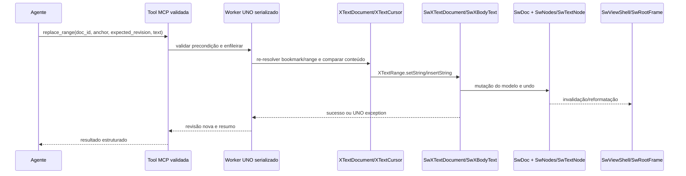
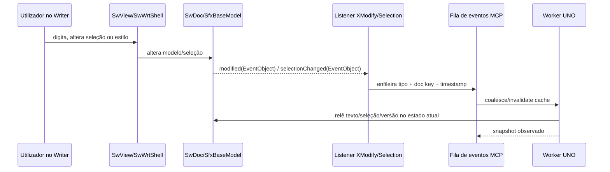

# Mapa do código-fonte Writer

Fonte principal desta inspeção: `CodigoFonte/core-git`, commit `2431868f2abd904d682010175ea966e9b78bc2d6`. As referências abaixo são caminhos relativos à raiz desse checkout. O texto é orientador; confirme números de linha na mesma revisão antes de preparar um patch futuro.

## Mapa de diretórios e dependências

| Área | Responsabilidade observada | Exemplos |
|---|---|---|
| `sw/inc/` | Contratos/classes centrais do Writer: modelo, posições, nós, documento e interfaces internas. | `doc.hxx`, `docsh.hxx`, `view.hxx`, `viewsh.hxx`, `ndarr.hxx`, `ndtxt.hxx`, `pam.hxx`, `unotxdoc.hxx`. |
| `sw/source/core/doc/` | Construção e estado/modelo do documento. | `docnew.cxx` constrói `SwDoc`; gerentes de documento e estado. |
| `sw/source/core/crsr/` | Cursor e posições/ranges no modelo. | `crsrsh.cxx`, `pam.cxx`. |
| `sw/source/core/unocore/` | Adaptadores UNO para estrutura e objetos Writer. | `unotext.cxx`, `unoparagraph.cxx`, `unotbl.cxx`, `unostyle.cxx`, `unofield.cxx`, `unoframe.cxx`, `unobkm.cxx`, `unoredline.cxx`. |
| `sw/source/core/layout/` | Árvore de layout e frames/paginação; transforma modelo em disposição visual. | `rootfrm.hxx`, `newfrm.cxx` e classes `SwFrame`. |
| `sw/source/core/access/` | Interfaces de acessibilidade e representação navegável do conteúdo visual. | `accpara.*`, `accframe.*`, `acccontext.*`. |
| `sw/source/uibase/uno/` | Modelo UNO de documento, controlador de view/seleção, dispatch e integração de UI. | `unotxdoc.cxx`, `unotxvw.cxx`, `unomodule.cxx`, `unodispatch.cxx`. |
| `sw/source/uibase/uiview/`, `wrtsh/`, `app/` | View gráfica, shell de escrita, construção da janela e lifecycle da shell. | `view.cxx`, `wrtsh1.cxx`, `docshini.cxx`. |
| `sw/source/ui/` | Diálogos e componentes de interação do Writer. Não equivale à API de documento. | Implementações de UI e diálogos; `Library_swui.mk`. |
| `sw/source/filter/` e `sw/source/writerfilter/` | Importação/exportação e conversão de formatos. | ODF, OOXML, RTF, HTML, DocBook; writerfilter/dmapper. |
| `sw/sdi/swriter.sdi` | Declara slots/commands, itens e argumentos tipados usados no dispatch Sfx. | `.uno:TrackChanges`, `.uno:InsertTable`, `.uno:UpdateAllIndexes`, comandos de redline. |
| `sw/uiconfig/` | Menus, toolbars, notebookbar e outros XML de interface; contém referências de comando. | `sw/uiconfig/swriter/`. |
| `sw/qa/api/`, `sw/qa/python/` | QA de adaptadores UNO e comportamento Writer. | Testes C++ e scripts UNO Python para tables, fields, styles, bookmarks, annotations e outros. |
| `offapi/`, `udkapi/` | Definições IDL públicas de UNO e tipos gerados. | `com/sun/star/text`, `document`, `view`, `frame`, `util`. |
| `sfx2/` | Modelo genérico de documento, shells, dispatcher/bindings, undo, armazenamento e broadcaster. | `SfxBaseModel`, `SfxDispatcher`, `SfxBindings`, `SfxViewFrame`. |
| `framework/`, `desktop/`, `vcl/`, `svx/`, `editeng/` | Frame/dispatch, boot desktop, janela/VCL, desenho/objetos, edição e formatação compartilhados. | Dependências de `sw/Library_sw.mk` e `Library_swui.mk`. |
| `pyuno/`, `cppu/`, `cppuhelper/`, `sal/`, `comphelper/` | Bridge de linguagem, runtime UNO, componente, tipos e utilitários. | Ligação entre cliente Python e objetos UNO C++. |

`sw/Module_sw.mk` inclui bibliotecas `sw`, `swui`, `sw_writerfilter`, `msword`, `swd`, configurações de UI e alvos CppUnit/slowcheck (ODF, OOXML, RTF, UIWriter etc.). `sw/Library_sw.mk` declara dependência de APIs `udkapi`, `offapi`, `oovbaapi` e bibliotecas como `sfx`, `svx`, `editeng`, `vcl`, `fwk`, `comphelper`, `cppu` e `cppuhelper`. `sw/Library_swui.mk` compila uma parte grande dos diálogos/UI. Esses makefiles são o mapa de dependência, não prova de que os alvos podem ser construídos no ambiente atual.

## Classes centrais

| Classe | Responsabilidade e API relevante | Definição / implementação | UNO, GUI e extensão |
|---|---|---|---|
| `SwDoc` | Modelo semântico do Writer; possui `SwNodes` e serviços documentais; `GetNodes()` em `sw/inc/doc.hxx:445`, `GetIDocumentUndoRedo()` em `:503`. | `sw/inc/doc.hxx:207`; construtor em `sw/source/core/doc/docnew.cxx:211`. | Núcleo C++; externo só através dos wrappers UNO/document shell. Ponto de extensão: interface document-level, não acesso cru a ponteiros. |
| `SwDocShell` | Sfx shell do documento Writer; recupera `SwDoc` e `SwWrtShell` (`sw/inc/docsh.hxx:215,236`). | `sw/inc/docsh.hxx`; construtores `sw/source/uibase/app/docshini.cxx:318+`. | Integra lifecycle, storage e view. `SwXTextDocument` mantém ligação à shell. |
| `SwView` | View Writer para janela/controlador; possui `SwWrtShell`; `GetWrtShell()` em `sw/inc/view.hxx:436`. | `sw/inc/view.hxx`; ctor `sw/source/uibase/uiview/view.cxx:769`. | Lado UI. Notifica seleção UNO em `view.cxx:538,622`. |
| `SwViewShell` | Shell de layout/renderização e acesso ao documento/nós; `GetNodes`, `GetDoc`, undo. | `sw/inc/viewsh.hxx:117,223,321,367`; ctor `sw/source/core/view/vnew.cxx:183`. | Relaciona modelo e layout; não é uma API remota/estável para chamar diretamente. |
| `SwWrtShell` | Operações de edição contextual/UI, cursor, seleção, tabelas e conteúdo; deriva de shells Writer. | `sw/source/uibase/inc/wrtsh.hxx:98`; construtores `sw/source/uibase/wrtsh/wrtsh1.cxx:2168+`. | Camada de edição gráfica; UNO pode acionar capacidades via controller/dispatch. Não usar ABI C++ interna de fora. |
| `SwCursorShell` | Gestão de cursor atual, seleção e navegação do shell. | `sw/inc/crsrsh.hxx:162`; `sw/source/core/crsr/crsrsh.cxx`. | Modelo de posição compartilhado com view; ranges externos são `XTextCursor`/`XTextRange`. |
| `SwPaM` | Ponto e marca de range/seleção; `GetPoint()`/`GetMark()` em `sw/inc/pam.hxx:251-254`, `GetText()` em `:310`. | `sw/inc/pam.hxx:185`; `sw/source/core/crsr/pam.cxx`. | Representação interna; offsets não constituem ID persistente do parágrafo. Expor apenas via interfaces UNO seguras. |
| `SwNodes` | Árvore/array estrutural de nós e documentos, incluindo nós de texto e limites estruturais. | `sw/inc/ndarr.hxx:105`; `sw/source/core/docnode/nodes.cxx`. | Endereçamento interno muda sob mutações; não exportar índices como IDs duráveis. |
| `SwTextNode` | Conteúdo textual e atributos de um nó-parágrafo; `GetText()` em `sw/inc/ndtxt.hxx:257`. | `sw/inc/ndtxt.hxx:116`; `sw/source/core/txtnode/ndtxt.cxx:213`. | UNO apresenta parágrafo, portions e cursores, não exige conhecer offsets de node. |
| `SwRootFrame` | Raiz da árvore de layout/paginação de uma view. | `sw/source/core/inc/rootfrm.hxx:83`; construção em `sw/source/core/layout/newfrm.cxx:401`. | Dependente da view e layout. Para clientes, usar `XPageCursor`, renderização e accessibility. |
| `SwUndo` | Ação interna base/hierarquia de undo Writer; não é a API de undo de cliente. | `sw/inc/undobj.hxx:52`; `sw/source/core/undo/undobj.cxx`. | API estável externa é `XUndoManager` (`enterUndoContext`, `undo`, `redo`). |
| `SfxDispatcher` | Resolve e executa slots para a shell/contexto ativo; `Execute`, `GetSlot`, `QueryState`. | `include/sfx2/dispatch.hxx:73,112-161`. | `SfxBindings` e `SfxViewFrame` atendem UI interna; cliente externo deve preferir `XDispatchProvider`/`XDispatch`. |
| `SfxBindings` | Estado/ligação de comandos UI; `QueryState` e `Execute`. | `include/sfx2/bindings.hxx:78,150-178`. | O estado de slot depende do shell/seleção atual; não é um catálogo de capacidades universal. |
| `SfxViewFrame` | Associa frame com view shell, dispatcher e bindings. | `include/sfx2/viewfrm.hxx:50,115-117`. | Conecta janela e comandos. UNO `XFrame`/`XController` são a fronteira externa. |
| `SfxObjectShell` / `SfxBaseModel` | Modelo genérico, armazenamento, estado modificado, interfaces base/eventos. | `include/sfx2/objsh.hxx:188`; `sfx2/source/doc/sfxbasemodel.cxx`. | Base de `SwXTextDocument`; `addModifyListener` em `sfxbasemodel.cxx:1469`, broadcaster de eventos a partir de `:2598`. |
| `SwXTextDocument` | Fachada UNO para o `SwDocShell`, corpo, estilos, fields, tabelas, frames, bookmarks, redlines e render. | `sw/inc/unotxdoc.hxx:168-212`; `getText`/`getBodyText` em `sw/source/uibase/uno/unotxdoc.cxx:467-480`, controller em `:512-515`, redlines em `:2391`. | API principal do MCP; getTypes/runtime confirmou famílias de serviços. Usa wrapper C++ sob SolarMutex. |
| `SwXTextView` / `SwXTextViewCursor` | Seleção, cursor de view, página, listeners e objetos selecionados. | `sw/source/uibase/inc/unotxvw.hxx:67,152+`; `unotxvw.cxx:202,340-429,431-443,737-744`. | Interface de UI. `getSelection()` pode devolver `XIndexAccess`, `XTextTableCursor`, frame, imagem ou shapes conforme modo. |
| Wrappers UNO de conteúdo | `SwXParagraph`, `SwXTextTable`, `SwXTextFrame`, `SwXTextGraphicObject`, `SwXBookmark`, `SwXTextField`, `SwXRedline` adaptam componentes internos. | `sw/source/core/unocore/unoparagraph.cxx`, `unotbl.cxx`, `unoframe.cxx`, `unobkm.cxx`, `unofield.cxx`, `unoredline.cxx`. | É a superfície a usar a partir de Python. Nem todos os listener methods em todos os wrappers estão implementados. |

## Fluxos de operação

### Edição textual por UNO

### Digitação do utilizador e sincronização

O segundo fluxo é uma estratégia de polling orientada por notificações. O callback genérico não inclui delta; a janela pode mudar antes de o worker reler, pelo que a fila deve representar “estado sujo”, não uma sequência exata de operações.

## APIs/serviços UNO de interesse

- Documento: `com.sun.star.text.XTextDocument`, `XText`, `XTextRange`, `XTextCursor`, `XParagraphCursor`, `XWordCursor`, `XSentenceCursor`, `XTextRangeMover`, `XSearchable`, `XReplaceable`.
- Estrutura e objetos: `XStyleFamiliesSupplier`, `XTextTablesSupplier`, `XTextFramesSupplier`, `XTextGraphicObjectsSupplier`, `XTextEmbeddedObjectsSupplier`, `XTextFieldsSupplier`, `XBookmarksSupplier`, `XReferenceMarksSupplier`, `XFootnotesSupplier`, `XEndnotesSupplier`, `XDocumentIndexesSupplier`, `XTextSectionsSupplier`, `XContentControlsSupplier`, `XRedlinesSupplier`.
- Ciclo de vida/armazenamento: `XComponentLoader`, `XModel`, `XStorable`, `XCloseable`, `XModifiable`, `XDocumentPropertiesSupplier`.
- View e comandos: `XController`, `XSelectionSupplier`, `XTextViewCursorSupplier`, `XPageCursor`, `XDispatchProvider`, `XDispatch`, `XDispatchHelper`.
- Eventos e undo: `XModifyListener`, `XSelectionChangeListener`, `XDocumentEventBroadcaster`, `XUndoManagerSupplier`, `XUndoManagerListener`.

O objeto de documento criado em runtime 24.2 expôs 111 `Type` via `getTypes()`, incluindo `XUndoManagerSupplier`, `XDocumentEventBroadcaster`, `XModel3`, `XStorable2`, os principais suppliers Writer e `XTextDocument`. Essa amostra é de um documento vazio nessa versão, não contrato universal para todos os componentes.

## Pontos de extensão e dependências

1. **External tool:** UNO no Python, sem alterar o Writer; indicado para primeira entrega.
2. **Extensão UNO:** bootstrap de sessão, painel/menu, eventos/commands de produto, integração externa. Ver componentes declarados pela UI/serviços e mecanismos de `desktop`/`framework`.
3. **Alteração C++:** novo IDL em `offapi` mais implementação em `sw`/`sfx2` para eventos nativos ou identidade persistente. Exige build configurado e testes CppUnit/API/GUI/export.
4. **Compatibilidade:** o runtime instalado 24.2, o wrapper 26.8 alpha e o checkout master são três referências distintas. Fixar versão binária e SDK na distribuição e executar a matriz de QA sobre essa combinação.

## O que o mapa não declara

O acesso interno a `SwDoc`, `SwNodes`, `SwPaM`, frames ou dispatcher por ponteiro C++ não é recomendado como interface do MCP: cria acoplamento ao ABI, exige execução dentro do processo LibreOffice e pode quebrar invariantes/solar mutex. A existência de uma função interna não significa que uma chamada externa Python a possa usar. Expor primeiro por UNO ou extensão/componentes.
